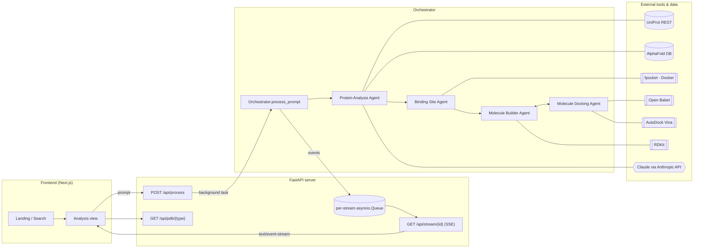
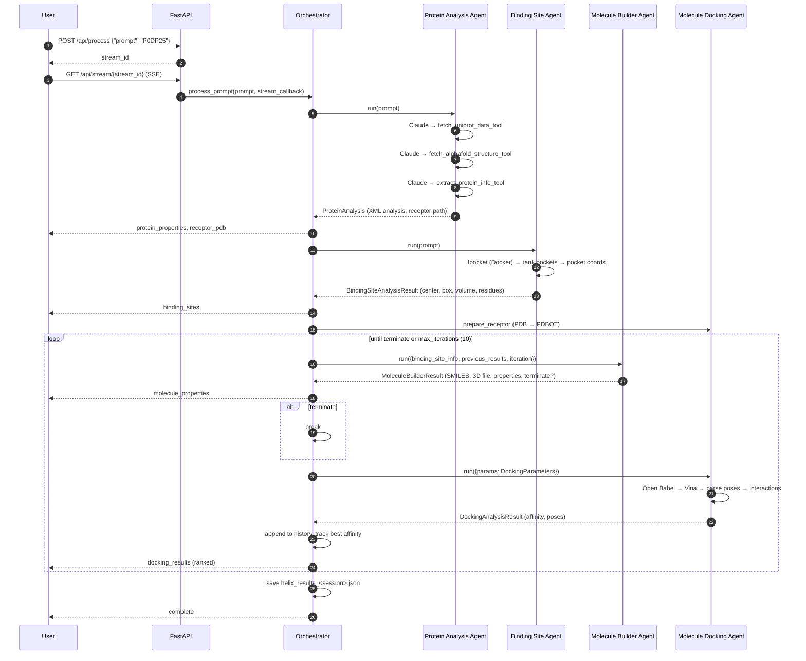

# Helix

**An agentic, AI-driven drug discovery pipeline.** Give Helix a UniProt protein ID and a team of specialised agents fetches the protein, predicts where a drug could bind, designs candidate molecules, docks them with AutoDock Vina, and iteratively refines the chemistry, streaming every step live to a web UI.

```
UniProt ID  ──►  Protein Analysis  ──►  Binding Site Detection  ──►  ┌─ Molecule Design ◄─┐  ──►  Best candidate
 (P0DP25)        (UniProt + AlphaFold)   (fpocket + Vina box)        └──► Docking (Vina) ─┘       + results JSON
```

---

## Table of Contents

- [Overview](#overview)
- [Features](#features)
- [Architecture](#architecture)
  - [Repository layout](#repository-layout)
  - [System diagram](#system-diagram)
  - [Backend](#backend)
  - [Frontend](#frontend)
  - [Streaming protocol (SSE)](#streaming-protocol-sse)
  - [Outputs](#outputs)
- [Agentic Workflow](#agentic-workflow)
  - [1. Protein Analysis Agent](#1-protein-analysis-agent)
  - [2. Binding Site Agent](#2-binding-site-agent)
  - [3. Receptor preparation](#3-receptor-preparation)
  - [4. Molecule Builder Agent](#4-molecule-builder-agent)
  - [5. Molecule Docking Agent](#5-molecule-docking-agent)
  - [6. The optimisation loop](#6-the-optimisation-loop)
- [How to Run](#how-to-run)
  - [Prerequisites](#prerequisites)
  - [Backend setup](#backend-setup)
  - [Frontend setup](#frontend-setup)
  - [Running a pipeline](#running-a-pipeline)
  - [Standalone agent scripts](#standalone-agent-scripts)
- [Configuration reference](#configuration-reference)
- [Tech stack](#tech-stack)
- [Current status & known limitations](#current-status--known-limitations)
- [License](#license)

---

## Overview

Early-stage drug discovery means chaining many bioinformatics and cheminformatics tools together: look up a target, get its 3D structure, find pockets, propose ligands, dock them, interpret the scores, tweak the molecule, repeat. Each step uses a different tool, file format and set of conventions.

Helix wraps that chain in a **multi-agent system** built on [pydantic-ai](https://ai.pydantic.dev/) and Anthropic's Claude models:

- A **Protein Analysis Agent** uses Claude with tool calling to pull data from **UniProt** and **AlphaFold**, compute physicochemical properties with **Biopython**, and write a structured scientific analysis.
- A **Binding Site Agent** runs **fpocket** (in Docker) to detect cavities and turns the best pocket into an AutoDock Vina search box.
- A **Molecule Builder Agent** designs ligands with **RDKit**: it starts from a scaffold and applies SMARTS reaction transforms chosen from the pocket's chemistry and the docking history.
- A **Molecule Docking Agent** prepares structures with **Open Babel** and docks each candidate with **AutoDock Vina**.
- An **Orchestrator** runs the agents in sequence, drives the design → dock → refine loop until it converges, and streams progress to the client over **Server-Sent Events**.

A **Next.js 15 / React 19** frontend provides the landing page, protein search and an animated analysis view with a 3D (three.js) scene.

---

## Features

**Protein intelligence**
- Fetches name, organism and sequence from the UniProt REST API.
- Downloads the predicted 3D structure from the AlphaFold Protein Structure Database.
- Computes sequence descriptors with Biopython `ProtParam`: molecular weight, pI, GRAVY, instability index, aromaticity, secondary-structure fractions, charge at pH 7, extinction coefficients, flexibility and Kyte-Doolittle hydrophobicity profiles, and residue class fractions.
- Claude writes a structured `<ProteinAnalysisResult>` covering sequence, structure, functional implications and caveats.

**Binding site detection**
- Pocket detection with fpocket (run through the official `fpocket/fpocket` Docker image).
- Parses every pocket descriptor in fpocket's `*_info.txt` (score, druggability, volume, …). fpocket already ranks the pockets, and Helix takes the top one.
- Computes the pocket centre and a padded search box (atom extent + 8 Å), and writes a Vina config file.

**Molecule design**
- RDKit-based SMILES → 3D conformer generation (ETKDG + force-field optimisation), exported to PDB/SDF/PDBQT.
- Property calculation: MW, cLogP, HBD/HBA, TPSA, rotatable bonds, rings and heavy atoms, checked against Lipinski and Veber rules.
- SMARTS reaction-based modification (`modify_molecule_via_smarts`) for structure-guided edits.
- Picks the next modification strategy from pocket polarity and current properties (add a polar group, add a hydrophobic group, or scaffold-hop).
- Chain-of-thought audit logs for every design decision (`helix_output/logs/molecule_builder_cot_*.json`).

**Docking**
- Receptor PDBQT preparation through Open Babel (`-xr`, pH 7.4 protonation), and ligand conversion with hydrogens added (`-xh`).
- AutoDock Vina docking with configurable exhaustiveness, number of modes, energy range and scoring function (`vina`, `vinardo`, `ad4`).
- Optional flexible-residue docking, affinity-map generation (`autogrid4`), virtual screening across ligand libraries, PyMOL visualisation scripts and HTML interaction maps.
- Affinity and RMSD bounds for each pose, parsed from Vina's output table.

**Orchestration & API**
- Iterative optimisation loop with convergence-based early stopping.
- FastAPI server with background task execution.
- Real-time SSE stream of logs, progress, protein properties, receptor PDB, binding sites, molecule properties and ranked docking results.
- Endpoints that return the receptor, ligand and best docked pose for 3D viewers.
- Full results saved to JSON for each session.
- Observability through [Logfire](https://logfire.pydantic.dev/): every agent run and tool call is traced.

**Frontend**
- Dark, gradient UI built with Tailwind CSS and shadcn/ui (Radix primitives).
- Interactive 3D molecular scene with `@react-three/fiber` and `drei`.
- Protein search by UniProt ID and a step-by-step analysis progress view.

---

## Architecture

### Repository layout

```
helix/
├── backend/                         # Python: agents, orchestrator, API
│   ├── core/
│   │   ├── orchestrator.py          # Pipeline driver + streaming callbacks
│   │   ├── agents/
│   │   │   ├── protein_analysis_agent.py   # UniProt + AlphaFold + Biopython (LLM tool-calling)
│   │   │   ├── binding_site_agent.py       # fpocket → pocket → Vina box
│   │   │   ├── molecule_builder_agent.py   # RDKit design + SMARTS edits + CoT logs
│   │   │   └── molecule_docking_agent.py   # Open Babel prep + AutoDock Vina
│   │   └── utils/
│   │       ├── get_uniprot.py       # UniProt REST client
│   │       ├── get_structure.py     # AlphaFold DB downloader
│   │       ├── get_info.py          # Biopython ProtParam feature extraction
│   │       └── logger.py            # Logfire-backed logger
│   ├── server/
│   │   ├── app.py                   # FastAPI app, CORS, error handlers
│   │   ├── run.py                   # `python -m server.run`
│   │   └── routes/                  # health, prompt (/api/process), stream (/api/stream, /api/pdb)
│   ├── tests/
│   │   ├── test_mba.py              # Molecule Builder Agent harness
│   │   └── test_mda.py              # Molecule Docking Agent harness (CLI)
│   ├── examples/                    # Sample receptor/ligand PDBQT + Vina config
│   ├── requirements.txt
│   └── .env.example
├── frontend/                        # Next.js 15 (App Router) + React 19
│   ├── app/
│   │   ├── page.tsx                 # Landing page + UniProt search
│   │   ├── analysis/page.tsx        # Analysis progress view
│   │   ├── layout.tsx, globals.css, loading.tsx
│   ├── components/
│   │   ├── protein-model.tsx        # three.js molecule scene
│   │   ├── ui/                      # shadcn/ui components
│   │   └── theme-provider.tsx, icons.tsx
│   ├── hooks/, lib/, public/, styles/
│   ├── package.json
│   └── .env.example
├── docs/
│   └── sse-stream-handler.example.tsx   # Reference client-side SSE event handler
├── LICENSE
└── README.md
```

### System diagram



### Backend

| Layer | File(s) | Responsibility |
|-------|---------|----------------|
| **API** | `server/app.py` | Creates the FastAPI app, configures CORS (`http://localhost:8080`), registers routers and attaches CORS headers to error responses. |
| | `server/routes/prompt.py` | `POST /api/process`: creates a stream, schedules `run_orchestration` as a background task, returns the `stream_id`. When the run finishes, it registers the receptor, ligand and best-pose file paths for that stream. |
| | `server/routes/stream.py` | In-memory stream registry (`active_streams`, `stream_queues`, `stream_resources`). SSE generator with keep-alives (`:` comment each second, `keep_alive` event every 5 s). A lifespan task emits `status_update` events on streams idle for more than 30 s. Serves PDB text via `/api/pdb/{receptor\|ligand\|docking}`. |
| | `server/routes/health.py` | `/` and `/health`. |
| **Orchestration** | `core/orchestrator.py` | `Orchestrator.process_prompt(prompt, stream_callback)` runs the full pipeline. `run_with_progress_updates` wraps each long coroutine and sends interpolated progress ticks while it runs. It parses the XML analysis into UI-friendly `protein_properties`, tracks the best affinity and writes `helix_output/helix_results_<session>.json`. |
| **Agents** | `core/agents/*.py` | Each module defines a `pydantic_ai.Agent` with a detailed XML-style system prompt, a typed `result_type` (Pydantic model) and `@agent.tool_plain` tools. See [Agentic Workflow](#agentic-workflow). |
| **Utilities** | `core/utils/*.py` | Thin clients for UniProt and AlphaFold, the Biopython feature extractor and the Logfire logger. |

**Typed contracts between agents.** Every hand-off is a Pydantic model, so downstream steps receive validated data:

| Model | Produced by | Key fields |
|-------|-------------|-----------|
| `ProteinAnalysis` | Protein Analysis Agent | `protein_sequence`, `prepared_receptor_path`, `structure_type`, `resolution`, `analysis` (XML) |
| `BindingSiteAnalysisResult` | Binding Site Agent | `center[3]`, `box_size[3]`, `volume`, `polar_surface_area`, `apolar_surface_area`, `residues[]`, `binding_sites[]` |
| `MoleculeBuilderResult` | Molecule Builder Agent | `smiles`, `molecule_path`, `properties: MoleculeProperties`, `description`, `terminate`, `termination_reason` |
| `DockingParameters` | Orchestrator | receptor/ligand paths, box, `exhaustiveness=8`, `num_modes=9`, `energy_range=3.0`, `scoring_function` |
| `DockingAnalysisResult` | Molecule Docking Agent | `binding_affinity`, `top_poses: [DockingResult]`, `key_interactions`, `recommendations` |

### Frontend

- **Framework:** Next.js 15 (App Router), React 19, TypeScript. Scaffolded with v0.dev.
- **Styling:** Tailwind CSS 3, `tailwindcss-animate`, and shadcn/ui components (`components/ui/*`) built on Radix UI.
- **3D:** `three`, `@react-three/fiber` and `@react-three/drei`. `components/protein-model.tsx` renders a rotating, hover-reactive molecular scene used as the hero background and the analysis viewport.
- **Pages:**
  - `/`: hero, UniProt ID search (`/analysis?id=<UniProtID>`), and feature cards for Sequence Analysis, Structure Prediction and Drug Discovery.
  - `/analysis`: a four-stage progress timeline (Sequence Analysis → Structure Prediction → Binding Site Identification → Molecule Design), a 3D viewport and live status/elapsed-time cards.
- **Backend integration:** `docs/sse-stream-handler.example.tsx` is a reference implementation of the client-side SSE handler. It maps `log.agent` values (`analysis`, `binding`, `molecule`, `docking`) to UI views and handles `progress` events. See [Current status](#current-status--known-limitations).

### Streaming protocol (SSE)

1. `POST /api/process` with `{"prompt": "P0DP25"}` returns `{"status":"success","result":{"stream_id":"<uuid>"}}`.
2. Open `GET /api/stream/<uuid>` as an `EventSource`. Each message is `data: <json>\n\n`:

| `type` | Payload | Emitted when |
|--------|---------|--------------|
| `connected` | none | Stream opened |
| `progress` | `value: 0–100` | Continuously; 0–20 protein, 20–40 binding site, 42–50 receptor prep, 50–100 split across optimisation iterations |
| `log` | `data: {id, timestamp, agent, message, type: info\|success\|warning\|error}` | Every agent milestone. `agent` is `analysis`, `binding`, `molecule`, `docking` or `Orchestrator` |
| `protein_properties` | `data: {name, uniprotId, length, molecularWeight, structureSource}` | After protein analysis |
| `receptor_pdb` | `data: "<PDB text>"` | After the AlphaFold structure is available |
| `binding_sites` | `data: [{id, residues, confidence, volume, active, warning}]` | After pocket detection |
| `molecule_properties` | `data: {smiles, molecularWeight, logP, hBondDonors, hBondAcceptors, rotatableBonds, polarSurfaceArea, heavyAtoms, rings}` | After each molecule is built |
| `docking_results` | `data: [{candidate, site, affinity}]`, sorted best-first | After each docking run |
| `keep_alive` / `status_update` | `elapsed_seconds` / `inactive_time` | During long silent stretches |
| `complete` | none | Run finished (success or error) |

3. After `complete`, fetch structures with `GET /api/pdb/receptor|ligand|docking?stream_id=<uuid>`.

### Outputs

All paths are relative to `backend/` (the working directory of the server):

| Path | Contents |
|------|----------|
| `pdb_files/<UNIPROT>.pdb` | AlphaFold model |
| `pdb_files/<UNIPROT>_out/` | fpocket output (pockets, `*_info.txt`) and `vina_config.txt` |
| `molecule_files/` | Generated ligands (`<smiles>.pdb` / `.pdbqt`) |
| `docking_results/` | Receptor PDBQT, `<ligand>_docked.pdbqt` (all modes) and `*_pose_N.pdbqt` files |
| `helix_output/helix_results_<session>.json` | Full run summary: protein analysis, binding site, every iteration's molecule and docking result, best result |
| `helix_output/logs/molecule_builder_cot_<session>.json` | Molecule Builder chain-of-thought audit trail |

These directories are generated at runtime and are git-ignored.

---

## Agentic Workflow

Helix uses a **sequential pipeline with an inner feedback loop**. Each stage is a `pydantic_ai.Agent` with a domain-expert system prompt, typed output and a toolset. The orchestrator passes one agent's structured output to the next.



### 1. Protein Analysis Agent

`core/agents/protein_analysis_agent.py`. **Claude-driven tool calling.**

- **Role:** expert in computational biology and structural bioinformatics.
- **Tools:**
  | Tool | Purpose |
  |------|---------|
  | `fetch_uniprot_data_tool(uniprot_id)` | Name, organism and sequence from `rest.uniprot.org` |
  | `fetch_alphafold_structure_tool(uniprot_id)` | Downloads `AF-<id>-F1-model_v4.pdb` into `pdb_files/` |
  | `extract_protein_info_tool(sequence)` | Biopython ProtParam descriptors |
- **Prescribed workflow:** extract the ID from the prompt, fetch UniProt, fetch AlphaFold, analyse the sequence, then synthesise.
- **Output:** `ProteinAnalysis`. Its `analysis` field is an XML document (`<ProteinID>`, `<ProteinName>`, `<Organism>`, `<SequenceSummary>`, `<StructuralSummary>`, `<DetailedAnalysis>`, `<LimitationsAndCaveats>`) that the orchestrator parses with regex to build the UI's protein card.
- Retries: 3 (pydantic-ai re-prompts the model if the output fails validation).

### 2. Binding Site Agent

`core/agents/binding_site_agent.py`

- **Role:** find the most promising pocket and convert it into a docking search space.
- **Tools:**
  | Tool | Purpose |
  |------|---------|
  | `run_fpocket_tool(pdb_file)` | `docker run -v $PDB_FILES_DIR:/workdir fpocket/fpocket fpocket -f /workdir/<id>.pdb` |
  | `analyze_fpocket_results(fpocket_dir)` | Parses `<id>_info.txt` into one dict of descriptors per pocket, in fpocket's rank order |
  | `extract_pocket_coords(pocket_number, fpocket_dir)` | Reads `pocketN_atm.pdb` and computes the centre, the box size (extent + 8 Å), the box volume and estimated polar/apolar areas |
  | `generate_vina_config(...)` | Writes `vina_config.txt` for the chosen pocket |
- **Execution:** `binding_site_agent.run` is bound to the deterministic `run_binding_site_analysis`, which calls the tools in order and picks fpocket's top-ranked pocket. This keeps the stage reproducible. The tools stay registered on the agent, so an LLM-driven variant can be enabled by restoring the default `Agent.run`.
- **Input:** the raw prompt is used as the PDB file stem, so the prompt should be the bare UniProt ID (e.g. `P0DP25`).

### 3. Receptor preparation

The orchestrator calls `MoleculeDockingAgent.prepare_receptor()` **once** to convert the AlphaFold PDB into a docking-ready PDBQT (`obabel -xr -p 7.4`). Every docking iteration reuses that file.

### 4. Molecule Builder Agent

`core/agents/molecule_builder_agent.py`

- **Role:** medicinal chemist / CADD specialist. The system prompt encodes Lipinski (MW ≤ 500, LogP ≤ 5, HBD ≤ 5, HBA ≤ 10) and Veber (RotB ≤ 10, TPSA ≤ 140 Ų) rules, pocket-adaptation guidelines and termination criteria.
- **Tools:** `build_molecule_from_smiles`, `modify_molecule_via_smarts`, `calculate_properties` and `generate_3d_conformation` (RDKit, with Open Babel for PDBQT).
- **Execution:** `molecule_builder_agent.run` is bound to `run_molecule_builder`, a rule-based design policy:
  1. **Iteration 0:** start from a benzene scaffold (`c1ccccc1`).
  2. **Later iterations:** take the **best-scoring previous molecule**, compute the pocket **polarity ratio** `polar_area / (polar_area + apolar_area)`, then choose a transform:
     | Condition | SMARTS transform | Intent |
     |-----------|------------------|--------|
     | polarity > 0.6 and HBD+HBA < 4 | `[cH:1]>>[c:1](O)` | Add a hydroxyl for polar contacts |
     | polarity < 0.4 and LogP < 3 | `[cH:1]>>[c:1](C)` | Add a methyl for hydrophobic contacts |
     | otherwise | benzene → pyridine ring swap | Scaffold hop to explore new chemical space |
  3. Build the 3D conformer and calculate properties.
  4. **Convergence check:** with 3 or more results, if the top three affinities differ by less than 0.5 kcal/mol, set `terminate=True` and revert to the best structure.
  5. Every step's reasoning and decisions are written to the chain-of-thought log.
- **Fallbacks:** if a transform fails, the agent keeps the previous structure. On an optimisation error it falls back to benzene, and on a critical error to water (`O`) with `terminate=True`, so the loop always gets a valid result.

### 5. Molecule Docking Agent

`core/agents/molecule_docking_agent.py`

- **Role:** molecular docking specialist (AutoDock Vina).
- **Engine:** the `MoleculeDockingAgent` class provides `prepare_receptor`, `prepare_ligand` (Meeko), `generate_affinity_maps` (autogrid4), `perform_docking` (Vina CLI), `analyze_interactions`, `virtual_screening`, `evaluate_pose_stability`, `generate_visualization` (PyMOL script) and `generate_interaction_map` (HTML).
- **Tools exposed to the LLM:** `prepare_receptor_tool`, `prepare_ligand_tool`, `perform_docking_tool`, `analyze_interactions_tool` and `virtual_screening_tool`.
- **Execution:** `molecule_docking_agent.run` is bound to `run_docking_analysis`, which calls `perform_docking_tool` with the following steps:
  1. Convert the ligand to PDBQT if needed (`obabel -xh`).
  2. Run `vina --receptor … --ligand … --center_* --size_* --exhaustiveness 8 --num_modes 9 --energy_range 3`.
  3. Parse Vina's results table and record the affinity and RMSD bounds for each mode. A `*_pose_N.pdbqt` file is written per mode; for now each one is a copy of the full multi-model output.
  4. Analyse interactions on the best pose and generate recommendations (for example, "add H-bond donors" when the affinity is weaker than −7 kcal/mol).
- **Output:** `DockingAnalysisResult`.

### 6. The optimisation loop

```
             ┌────────────────────────────────────────────────────────────┐
             │                    previous_results                        │
             ▼                                                            │
  binding_site_info ──► Molecule Builder ──► (terminate?) ──yes──► stop   │
                             │ no                                         │
                             ▼                                            │
                     Molecule Docking ──► affinity (kcal/mol) ────────────┘
                                               │
                                               └──► best_result (lowest ΔG)
```

- **Feedback signal:** Vina binding affinity. Lower (more negative) is better.
- **Memory:** the full history of `(molecule, docking)` pairs goes back into the builder on each iteration.
- **Stopping:** the builder signals convergence, `max_iterations` (default 10) is reached, or the first iteration fails (later iteration failures are logged and the loop moves on).
- **Result:** the lowest-affinity candidate is reported as `best_result`, and every iteration is kept in the results JSON.

---

## How to Run

### Prerequisites

| Requirement | Why | Install |
|-------------|-----|---------|
| Python **3.10+** | Backend | [python.org](https://www.python.org/) / `pyenv` |
| Node.js **18.18+** and **pnpm** | Frontend | `npm install -g pnpm` |
| **Docker** | fpocket runs in the `fpocket/fpocket` image | [docker.com](https://www.docker.com/) then `docker pull fpocket/fpocket` |
| **AutoDock Vina** (`vina` on `PATH`) | Docking | `conda install -c conda-forge vina` or a [release binary](https://github.com/ccsb-scripps/AutoDock-Vina/releases) |
| **Open Babel** (`obabel` on `PATH`) | PDB ↔ PDBQT conversion | `brew install open-babel` / `conda install -c conda-forge openbabel` / `apt install openbabel` |
| **RDKit** | Molecule building and properties | `pip install rdkit` |
| Meeko *(optional)* | Ligand prep via `prepare_ligand_tool` | `pip install meeko` |
| Anthropic API key | Claude powers the agents | [console.anthropic.com](https://console.anthropic.com/) |
| Logfire token *(optional)* | Tracing | [logfire.pydantic.dev](https://logfire.pydantic.dev/) |

> **Tip:** conda is the easiest way to get Vina, Open Babel and RDKit together:
> `conda create -n helix -c conda-forge python=3.11 vina openbabel rdkit && conda activate helix`

### Backend setup

```bash
cd backend

# 1. Create an environment (skip if you're using the conda env above)
python -m venv .venv
source .venv/bin/activate            # Windows: .venv\Scripts\activate

# 2. Install Python dependencies
pip install -r requirements.txt
pip install rdkit                    # not pinned in requirements.txt

# 3. Configure environment variables
cp .env.example .env
#   then edit .env and set ANTHROPIC_API_KEY and ANTHROPIC_MODEL_NAME

# 4. Make sure the external tools are reachable
vina --version && obabel -V && docker info > /dev/null && echo "tools OK"

# 5. Start the API (always run from backend/, because output paths are relative to it)
python -m server.run --reload        # http://localhost:8000  (docs at /docs)
```

### Frontend setup

```bash
cd frontend
cp .env.example .env.local
pnpm install
pnpm dev                             # http://localhost:3000
```

Production build: `pnpm build && pnpm start`.

> **CORS note:** the backend only allows `http://localhost:8080` (`server/app.py` and the explicit headers in `server/routes/*.py`). To call it from the Next.js dev server, either run the frontend on port 8080 (`pnpm dev -p 8080`) or add `http://localhost:3000` to the allowed origins.

### Running a pipeline

You can drive the backend directly with `curl`:

```bash
# Start a run (the prompt is the bare UniProt ID)
STREAM_ID=$(curl -s -X POST http://localhost:8000/api/process \
  -H 'Content-Type: application/json' \
  -d '{"prompt": "P0DP25"}' | python -c 'import sys,json;print(json.load(sys.stdin)["result"]["stream_id"])')

# Watch the live event stream
curl -N http://localhost:8000/api/stream/$STREAM_ID

# When you see {"type": "complete"}, fetch structures
curl "http://localhost:8000/api/pdb/receptor?stream_id=$STREAM_ID" -o receptor.pdb
curl "http://localhost:8000/api/pdb/docking?stream_id=$STREAM_ID"  -o best_pose.pdbqt
```

Results are written to `backend/helix_output/helix_results_<session>.json`.

**Good test targets:** `P0DP25` (Calmodulin-3, small and fast), `P0DP23` (Calmodulin-1), `P68871` (Hemoglobin β) and `P01308` (Insulin).

### Standalone agent scripts

Run these from `backend/`:

```bash
# Dock the bundled example receptor/ligand using a Vina config
python -m tests.test_mda --mode config --config examples/vina_config.txt

# Other docking modes: basic | flexible | virtual_screening | ai
python -m tests.test_mda --mode basic --receptor <receptor.pdb> --ligand <ligand.pdb> \
  --center 15.19 53.90 16.92 --box_size 20 20 20

# Molecule Builder: reads $PDB_FILES_DIR/vina_config.txt and builds a ligand for it
python -m tests.test_mba
```

---

## Configuration reference

**`backend/.env`**

| Variable | Required | Description |
|----------|----------|-------------|
| `ANTHROPIC_API_KEY` | ✅ | Anthropic API key used by all agents |
| `ANTHROPIC_MODEL_NAME` | ✅ | Claude model ID, e.g. `claude-sonnet-5-5` |
| `LOGFIRE_API_KEY` | ➖ | Logfire write token for tracing |
| `PDB_FILES_DIR` | ➖ | Where AlphaFold PDBs and fpocket output go (default `pdb_files`) |

**`frontend/.env.local`**

| Variable | Description |
|----------|-------------|
| `NEXT_PUBLIC_API_URL` | Base URL of the backend (default `http://localhost:8000`) |

**Tunable pipeline parameters** (in code):

| Parameter | Location | Default |
|-----------|----------|---------|
| `max_iterations` | `Orchestrator(config={"max_iterations": N})` | 10 |
| `exhaustiveness`, `num_modes`, `energy_range` | `core/orchestrator.py` → `DockingParameters` | 8, 9, 3.0 |
| Convergence threshold | `run_molecule_builder` | < 0.5 kcal/mol across the top 3 |
| Server host/port | `python -m server.run --host --port` | `0.0.0.0:8000` |

---

## Tech stack

| Area | Technologies |
|------|--------------|
| **Agents / LLM** | pydantic-ai, Anthropic Claude, Pydantic v2 |
| **Bio / chem** | Biopython, RDKit, Open Babel, AutoDock Vina, fpocket, Meeko, NumPy, SciPy |
| **Data sources** | UniProt REST API, AlphaFold Protein Structure Database |
| **API** | FastAPI, Uvicorn, Starlette, SSE (StreamingResponse) |
| **Observability** | Logfire (OpenTelemetry) |
| **Frontend** | Next.js 15, React 19, TypeScript, Tailwind CSS, shadcn/ui, Radix UI, three.js, @react-three/fiber, @react-three/drei, Recharts, lucide-react |

---

## Current status & known limitations

Helix is a research prototype. Before you build on it, note the following:

- **Frontend is not yet wired to the live backend.** `app/analysis/page.tsx` currently simulates stage progress on a timer and shows a fixed protein name. The SSE contract above and `docs/sse-stream-handler.example.tsx` describe how to connect it: `POST /api/process`, then an `EventSource` on `/api/stream/{id}`.
- **CORS is hard-coded to `http://localhost:8080`.** See the CORS note in [Frontend setup](#frontend-setup).
- **Interaction analysis is simulated.** `MoleculeDockingAgent.analyze_interactions` returns placeholder interactions. The affinities themselves come from real Vina runs.
- **Pocket surface areas and residues are placeholders.** `extract_pocket_coords` estimates polar and apolar area as a fixed 30% / 70% split of the box surface, and it returns an empty residue list. The polarity ratio is therefore always 0.3, so the Molecule Builder always picks the "add methyl" branch while LogP < 3. Computing real per-atom polarity from the fpocket pocket file would make the design policy pocket-aware.
- **Pose files are not split yet.** Each `*_pose_N.pdbqt` is a copy of the multi-model Vina output.
- **The secondary binding site is illustrative.** The orchestrator adds an example second pocket to the `binding_sites` event for UI purposes. Only the primary fpocket pocket is used for docking.
- **Three of the four stages run deterministically.** The Binding Site, Molecule Builder and Docking agents have `.run` bound to deterministic Python pipelines for reproducibility. Only the Protein Analysis stage makes live Claude tool-calling decisions.
- **`core/utils/get_structure.py` downloads a structure on import.** It has module-level example code that fetches `P0DP23` whenever the module is imported.
- **`requirements.txt` doesn't include RDKit or Meeko.** Install them separately, as shown above.
- **Streams are kept in memory.** Restarting the server drops active streams. Use Redis or similar for multi-worker deployments.

---

## License

Licensed under the [Apache License 2.0](LICENSE).
